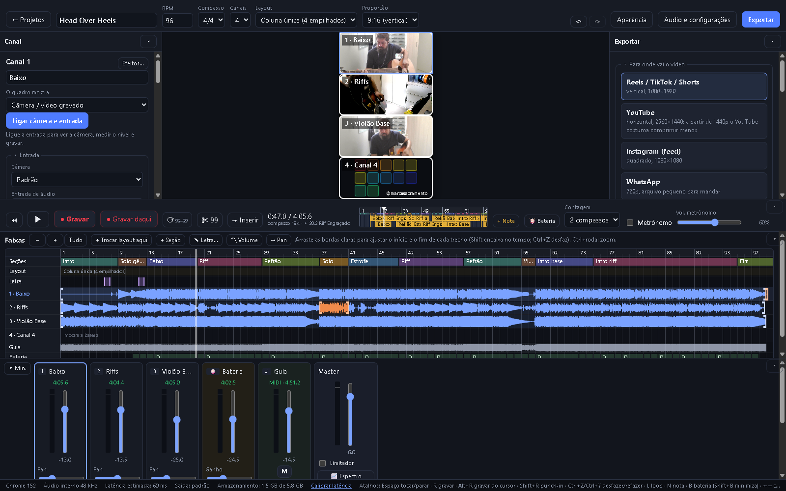

# Multicorder - VideoMusic Maker

App web para gravar vídeos musicais em grade de 2 a 6 canais (no estilo Acapella). Você grava um canal de cada vez, ouvindo os anteriores no fone, mixa com efeitos e exporta um MP4 pronto para as redes. Funciona com webcam e com interface de áudio USB.



**▶ Use online: [multivideomusicmaker.com.br](https://multivideomusicmaker.com.br)** (os projetos ficam só no seu navegador)

**➡ [Manual completo, com fotos de cada funcionalidade](docs/MANUAL.md)**

Navegadores: **Firefox desktop 130+** (o alvo principal) e **Chrome/Edge 126+**.

---

## Como rodar

No Windows, dê dois cliques em **`iniciar.bat`**. Ele sobe o servidor e abre o app no Firefox. Para parar, feche a janela preta (ou aperte Ctrl+C).

Pelo terminal:

```bash
python serve.py --open
```

O endereço é **http://localhost:8080**. `localhost` conta como contexto seguro, então câmera, microfone, OPFS e AudioWorklet funcionam sem HTTPS. Para usar em outra máquina, sirva a pasta por HTTPS.

**Portas:** os projetos ficam salvos no navegador, separados por endereço, e a porta faz parte do endereço. Use sempre a mesma porta (8080).
- Se o Multicorder já estiver rodando, o `iniciar.bat` só abre o navegador.
- Se outro programa estiver usando a 8080, ele usa a próxima livre (8081…) e avisa. Nesse endereço, os projetos da 8080 não aparecem.
- Para escolher outra porta: `iniciar.bat 8090`.

**Ícone e instalação:**
- O app tem ícone na aba e na tela inicial (pasta `icons/`, desenho em `icons/icon.svg`).
- **Instalar como aplicativo**: no Chrome ou no Edge, use o botão de instalar da barra de endereço. O app ganha janela própria e ícone no menu Iniciar; o `iniciar.bat` precisa continuar rodando.
- **Atalho com ícone**: crie um atalho para o `iniciar.bat` e, em *Propriedades → Alterar ícone…*, escolha `icons/multicorder.ico`.

Não há etapa de build: é JavaScript puro com módulos ES. As únicas dependências externas são baixadas de cdn.jsdelivr.net na hora de exportar:
- o empacotador MP4/WebM (`mp4-muxer` / `webm-muxer`);
- e, só em navegadores sem AAC (Firefox no Windows), o codificador AAC do FFmpeg em WebAssembly (`@mediabunny/aac-encoder`, ~1 MB; FFmpeg sob LGPL-2.1, wrapper sob MPL-2.0).

**Publicar na internet (AWS):** o app é só arquivos estáticos, então dá para publicar num bucket S3 com CloudFront (HTTPS e CDN). O passo a passo, com o modelo de infraestrutura e o script que envia os arquivos com os tipos e o cache certos, está em [docs/PUBLICAR-AWS.md](docs/PUBLICAR-AWS.md).

**Cache:** o servidor local e a publicação na AWS usam as mesmas regras. A página, o código e os estilos ficam guardados no navegador, que só confere se mudaram (resposta 304, sem baixar de novo). Os kits de bateria e os ícones ficam guardados por 1 dia sem nem conferir.

---

## Primeiros passos

1. Na tela inicial, crie um projeto: nome, BPM, compasso, 2 a 6 canais, layout e proporção.
2. **Áudio e configurações → Calibrar**, com o fone encostado no microfone (ou um cabo da saída para a entrada 1). Uma vez por equipamento.
3. Selecione um canal (clique no quadro ou aperte 1 a 6) → **Ligar câmera e entrada** → escolha a entrada 1, 2 ou estéreo.
4. **R** grava, com contagem. Os outros canais tocam no fone, e o metrônomo nunca é gravado.
5. Ajuste o mixer e os efeitos e exporte pela coluna **Exportar**.

O passo a passo completo está no [manual](docs/MANUAL.md#5-primeira-gravação-passo-a-passo).

---

## O que o app faz

| Área | Funções | No manual |
|---|---|---|
| **Projetos** | criar, duplicar, excluir, salvar e importar `.mcproj` (backup completo) | [Tela inicial](docs/MANUAL.md#2-tela-inicial) |
| **Tela** | canal à esquerda, prévia no centro, exportar à direita; gravação, faixas e mixer embaixo; tudo recolhível e sem rolagem | [A tela do projeto](docs/MANUAL.md#3-a-tela-do-projeto) |
| **Gravação** | contagem, metrônomo só no fone, gravar a partir de qualquer ponto, punch-in, várias tomadas por canal (e usar o melhor trecho de cada) | [Barra de gravação](docs/MANUAL.md#8-barra-de-gravação), [Tomada](docs/MANUAL.md#tomada) |
| **Entrada** | entrada 1, 2 ou estéreo, medidor com CLIP, teste de nível, retorno no fone, afinador, gravar dois canais juntos | [Coluna Canal](docs/MANUAL.md#6-coluna-canal) |
| **Limpeza e tom** | tirar chiado, estalos e puffs, silenciar partes sem som, mudar o tom sem mudar a velocidade | [Som da gravação](docs/MANUAL.md#som-da-gravação) |
| **Edição da música** | loop, remover e inserir compassos, seções (com duplicar seção), observações, ajuste fino das bordas, desfazer até 100 passos | [Barra de gravação](docs/MANUAL.md#8-barra-de-gravação), [Faixas](docs/MANUAL.md#9-faixas) |
| **Faixas** | onda do som por canal, legenda das cores, zoom, linhas de volume e de pan ao longo da música | [Faixas](docs/MANUAL.md#9-faixas) |
| **Vídeo** | dezenas de layouts (grades, mosaicos, destaque, PiP), trocas de layout no meio da música, letra/legenda na tela, marca d'água, aparência da grade | [Prévia e layouts](docs/MANUAL.md#7-prévia-e-layouts) |
| **Bateria** | 5 kits (4 acústicos gravados), padrões, grade com zoom e tercinas, swing, duração das batidas, pancada, sons próprios, MIDI (importar, exportar, controlador USB), tocar pelo teclado | [Bateria](docs/MANUAL.md#10-bateria) |
| **Mixer** | volume, pan, mudo, solo, faixa-guia (áudio ou MIDI), limitador, reverb compartilhado, espectro ao vivo | [Mixer](docs/MANUAL.md#11-mixer-e-faixa-guia) |
| **Efeitos** | predefinições por instrumento, EQ, gate, compressor, dobrar voz, chorus, distorção, wah, tremolo, eco, reverb | [Efeitos](docs/MANUAL.md#12-efeitos-do-canal) |
| **Exportação** | destinos prontos (Reels, YouTube, Instagram, WhatsApp), MP4/WebM de 720p a 4K, 30/60 fps, WAV do mix e faixas separadas | [Exportar](docs/MANUAL.md#13-exportar) |

Atalhos: Espaço tocar/parar · R gravar · Alt+R gravar do cursor · Shift+R punch-in · L loop · N nota · B bateria · 1–6 canal · Ctrl+Z/Ctrl+Y desfazer/refazer ([lista completa](docs/MANUAL.md#15-atalhos-de-teclado)).

---

## Detalhes técnicos

### Estrutura

```
index.html, styles.css, serve.py (servidor local de arquivos, com os tipos e o cache), iniciar.bat
icons/        ícone (SVG, PNG, ICO) e manifest.webmanifest na raiz
kits/         sons dos kits de bateria acústicos (CC0; créditos em kits/CREDITOS.txt)
docs/         MANUAL.md e as fotos (docs/manual/img); PUBLICAR-AWS.md
deploy/       aws-site.yaml (S3 + CloudFront, CloudFormation) e publicar-aws.ps1 (envio com tipos e cache)
src/engine/   motor (sem dependência de interface — RNF-14)
  audio-engine.js   AudioContext, transporte, metrônomo, entrada, monitoração, captura
  mix-graph.js      grafo de mixagem (o mesmo na reprodução e na exportação offline), linhas de volume/pan, espectro
  channel-strip.js  ganho → gate → HP → EQ → compressor → distorção → wah → chorus → dobrar voz → tremolo → eco → reverb → pan → fader → linha de volume
  worklets/         gravador PCM com carimbo de quadro + noise gate (AudioWorklet)
  recorder.js       tomada: PCM float32 + vídeo WebM salvos em blocos de 500 ms no OPFS
  calibration.js    latência ida e volta por loopback
  project.js        modelo do projeto: tomadas, punch-ins, cortes/inserções/duplicações de compassos, linhas, seções, letra
  exporter.js       OfflineAudioContext + Worker (export-worker.js) com WebCodecs
  webm-demux.js     leitor WebM (tolera arquivos cortados)
  layout.js         layouts da grade e trocas ao longo da música; compositor.js desenha a grade, a letra e a marca d'água (o mesmo na prévia e na exportação)
  storage.js        OPFS; archive.js: projeto em arquivo .mcproj
  pitch.js          afinador: detecção de frequência (YIN) e nota + cents
  dsp-worker.js     limpeza e tom da gravação fora da tela (estalos, puffs, chiado, partes sem som, mudar o tom); dsp.js é a ponte
  midi.js           leitor de .mid, guia em MIDI sintetizada e importação de .mid para a bateria
  drums.js          bateria: kits gravados e sintetizado, padrões em ticks (96 por tempo), áudio gerado por padrão
  aac-wasm.js       AAC do FFmpeg em WebAssembly (navegadores sem AAC no WebCodecs)
  avcc.js           monta a configuração H.264 do MP4 (avcC) a partir do SPS/PPS do vídeo
  peak-guard.js     limitador de pico verdadeiro (4×) do áudio do vídeo exportado
src/ui/       interface (DOM puro)
  app.js            estado, gravação, mídia, desfazer/refazer, teclado
  views/            workspace (tela), inspector (coluna Canal), export (coluna Exportar), timeline (régua),
                    tracks (faixas), drums (bateria), mixer, fx (efeitos), stage (prévia), spectrum, settings, home
```

### Como a sincronia funciona

O áudio é capturado num AudioWorklet que registra o número do quadro (`currentFrame`) da primeira amostra. Como a reprodução também é agendada pelo relógio do AudioContext, a posição de cada amostra gravada na linha do tempo é `quadro / taxa − T0 − latência calibrada`. No teste com loopback de 45,7 ms, as batidas gravadas ficaram a ≤ 0,52 ms da posição certa.

### Edição sem destruir

Remover, inserir ou duplicar compassos não altera os arquivos gravados. Cada operação fica guardada em `p.cuts`, e o som e o vídeo passam por elas na hora de tocar e de exportar (`takeSegments`, `mapRanges`). Por isso dá para desfazer. A limpeza e a mudança de tom também são feitas sobre uma cópia, no `dsp-worker.js`, e refeitas ao abrir o projeto.

### Exportação

- O app escolhe sozinho o nível do H.264 que cabe no tamanho, nos quadros por segundo e na taxa de bits (ex.: 1080p em Máxima passa dos 25 Mbps do nível 4.0 e sai em 4.1/4.2). Se o computador não aceitar a resolução, ele desce até uma que funcione e avisa.
- O MP4 sai no formato que Instagram, TikTok e celulares aceitam: H.264 High 4:2:0 (Main ou Baseline só se o computador não tiver High), quadros por segundo constantes, AAC-LC estéreo a 48 kHz e o índice (`moov`) no início.
- **avcC**: o codificador H.264 do Firefox (Windows) entrega a configuração do vídeo com o SPS/PPS repetido. PC e VLC tocam assim, mas celulares, Instagram e TikTok recusam o arquivo. O app remonta o `avcC` a partir do primeiro quadro-chave.
- **Quadros B**: o H.264 do sistema (usado pelo Firefox no Windows) gera quadros B. O app calcula a ordem de decodificação e atrasa o áudio na mesma medida; o arquivo começa com 1–2 quadros (33–66 ms) vazios, com áudio e vídeo alinhados.
- **Picos do áudio**: o vídeo sai com o pico verdadeiro (medido entre as amostras) em até −1,5 dBTP, mesmo com o limitador do master desligado, e amostras inválidas (NaN) viram silêncio. Assim o áudio não estoura num conversor ou na recompressão da rede social. O WAV do mix e as faixas separadas não passam por essa proteção.

### Bateria

- **Kits**: Rock, Jazz, Swirly e Unruly são baterias acústicas gravadas, com 4 camadas de força e 2 variações por som; Eletrônico é sintetizado. Palmas, shaker e pandeiro vêm do kit sintetizado (o cowbell também, exceto no Swirly). Os sons ficam em `kits/` (11 a 14 MB por kit) e funcionam sem internet.
- As batidas são guardadas com 96 divisões por tempo, então mudar o zoom ou a grade nunca muda as batidas de lugar.
- O MIDI exportado usa o canal 10 e as notas General MIDI (36 bumbo, 38 caixa, 42 chimbal…), com swing, força e duração.

---

## Limitações conhecidas

- Firefox: sem `AudioContext.setSinkId`. O som sai pela saída padrão do sistema, e o app mostra como configurá-la.
- No máximo 2 entradas por dispositivo, em qualquer navegador.
- Se o WebCodecs do sistema não tiver H.264/AAC, a exportação cai automaticamente para WebM.
- Firefox (Windows) não tem codificador AAC próprio: o app usa o AAC do FFmpeg em WebAssembly. Sem internet na hora de exportar, ele não carrega e o áudio sai em Opus, que toca em navegadores e no VLC, mas não no player do Windows, no WhatsApp nem no iPhone.
- A exportação respeita mudo e solo (com aviso). Solo em canal sem gravação é ignorado.
- A captura é sempre em WebM, inclusive no Chrome. A exportação é que gera o MP4.
- Não desfazem com Ctrl+Z: gravações, punch-ins gravados ou removidos, tomadas apagadas, troca de tomada, troca do arquivo da faixa-guia e escolha de câmera e entrada.
- O punch-in para sozinho no fim do trecho só com a aba do app em primeiro plano.
- Não implementados: importar um vídeo pronto para um quadro (RF-19) e filtros de cor (RF-43).

---

## Licença

Código sob a licença [MIT](LICENSE). Os sons dos kits de bateria em `kits/` são de domínio público (CC0 1.0); a origem de cada um está em [kits/CREDITOS.txt](kits/CREDITOS.txt). As bibliotecas baixadas na exportação seguem as próprias licenças (veja [Como rodar](#como-rodar)).
