# Manual do MultiCorder

O MultiCorder grava vídeos musicais em grade, com 2 a 6 quadros. Você grava um canal de cada vez, ouvindo no fone o que já foi gravado. Depois mixa, ajusta o vídeo e exporta um MP4 pronto para Reels, TikTok, YouTube, Instagram ou WhatsApp.

As fotos deste manual são do projeto **Head Over Heels**, gravado no próprio app: baixo, riffs e violão base em vídeo, mais um quadro com os pads da bateria.

## Sumário

1. [Antes de começar](#1-antes-de-começar)
2. [Tela inicial](#2-tela-inicial)
3. [A tela do projeto](#3-a-tela-do-projeto)
4. [Barra de cima](#4-barra-de-cima)
5. [Primeira gravação, passo a passo](#5-primeira-gravação-passo-a-passo)
6. [Coluna Canal](#6-coluna-canal)
7. [Prévia e layouts](#7-prévia-e-layouts)
8. [Barra de gravação](#8-barra-de-gravação)
9. [Faixas](#9-faixas)
10. [Bateria](#10-bateria)
11. [Mixer e faixa-guia](#11-mixer-e-faixa-guia)
12. [Efeitos do canal](#12-efeitos-do-canal)
13. [Exportar](#13-exportar)
14. [Desfazer, salvar e levar o projeto](#14-desfazer-salvar-e-levar-o-projeto)
15. [Atalhos de teclado](#15-atalhos-de-teclado)
16. [Dicas e problemas comuns](#16-dicas-e-problemas-comuns)

---

## 1. Antes de começar

**Você vai precisar de:**
- **Firefox** (130 ou mais novo) ou **Chrome/Edge** (126 ou mais novo), num computador.
- **Fone de ouvido**. Enquanto você grava, os outros canais tocam no fone; numa caixa de som, eles vazariam para o microfone.
- Câmera e microfone. Pode ser a webcam, mas uma interface de áudio USB dá mais qualidade. O app usa as entradas 1 e 2 dela.

**Como abrir:** no Windows, dê dois cliques em **`iniciar.bat`**. Ele liga o servidor e abre o app em **http://localhost:8080**. Para fechar, feche a janela preta.

> Os projetos ficam guardados no navegador, separados pelo endereço. Use sempre o mesmo navegador e a mesma porta (8080). Numa porta diferente, os projetos parecem ter sumido, mas continuam na outra.

---

## 2. Tela inicial

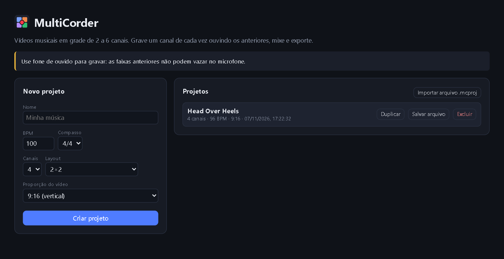

- **Novo projeto**: escolha o nome, o BPM, o compasso, quantos canais (2 a 6), o layout da grade e a proporção do vídeo (9:16 em pé, 1:1 quadrado ou 16:9 deitado). Tudo isso dá para mudar depois.
- **Projetos**: clique no nome para abrir.
  - **Duplicar** cria uma cópia, por exemplo para testar outra mixagem.
  - **Salvar arquivo** baixa o projeto inteiro (áudio, vídeo e ajustes) num arquivo **.mcproj**. Use para fazer backup ou levar para outro computador.
  - **Excluir** apaga o projeto (pede confirmação).
- **Importar arquivo .mcproj** traz de volta um projeto salvo. Ele entra como um projeto novo e nunca apaga um que já existe.

---

## 3. A tela do projeto

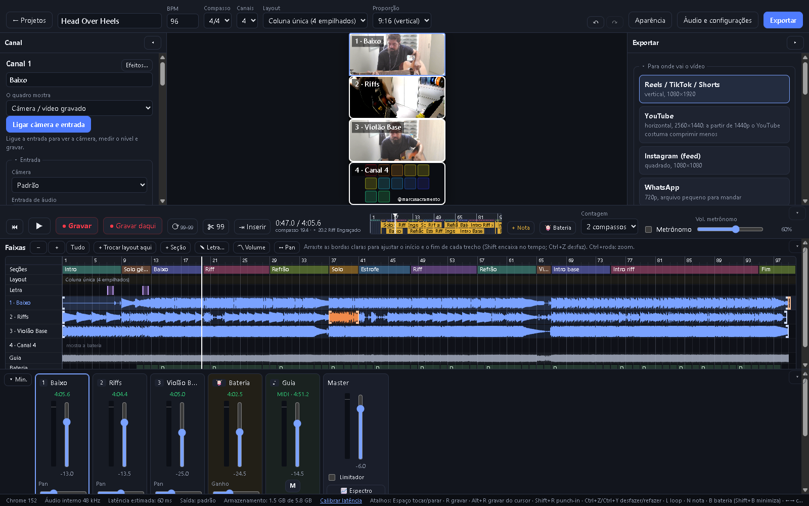

De cima para baixo:

| Parte | O que tem |
|---|---|
| **Barra de cima** | nome, BPM, compasso, canais, layout, proporção, desfazer/refazer, aparência, configurações e Exportar |
| **Coluna esquerda — Canal** | tudo do canal selecionado: entrada, imagem, tomada, som da gravação |
| **Centro** | a prévia do vídeo, exatamente como ele vai sair |
| **Coluna direita — Exportar** | destino, formato, qualidade, marca d'água e os botões de exportar |
| **Gravação** | botões de tocar e gravar, relógio, régua de compassos, contagem e metrônomo |
| **Faixas** | a onda do som de cada canal, seções, letra, trocas de layout, guia e bateria |
| **Bateria** | o editor de batidas (aparece quando você abre) |
| **Mixer** | volume, pan, mudo, solo e efeitos de cada canal, da bateria, da guia e do master |

**Recolher para ganhar espaço:**
- As duas colunas recolhem pelo **◂ / ▸** do título e viram uma tira fina. Clique na tira para abrir de novo.
- **Gravação**, **Faixas** e **Mixer** recolhem pela seta **▾** no canto direito e viram uma tira com o nome.
- Dentro das colunas, cada seção recolhe pela seta **▾** do título.
- O app lembra o que você deixou fechado.

A tela sempre cabe na janela, sem rolar. Recolhendo os blocos de baixo, a prévia cresce:

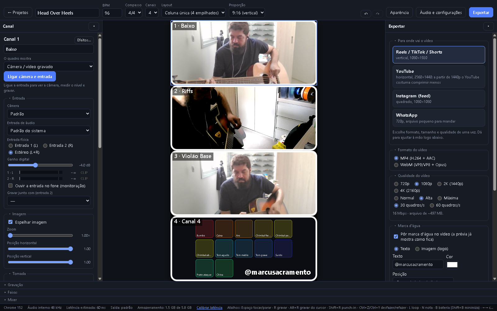

A **barra de status**, na última linha, mostra o navegador, a latência e o espaço livre para gravações. Parando o mouse sobre ela, aparecem todos os atalhos.

---

## 4. Barra de cima

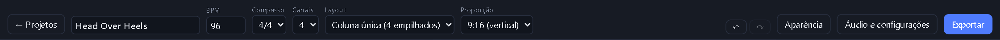

- **← Projetos** volta para a tela inicial.
- **Nome, BPM e Compasso**: mudar o BPM ajusta a bateria, o metrônomo e a régua. As gravações não mudam de velocidade.
- **Canais**: de 2 a 6. Ao diminuir, os canais do fim (e as gravações deles) saem, e o app pergunta antes.
- **Layout**: como os quadros se arrumam na tela (veja a [seção 7](#7-prévia-e-layouts)). Quando há trocas de layout no meio da música, ele passa a se chamar **Layout no início**.
- **Destaque** (só nos layouts com um quadro grande): qual canal fica grande.
- **Proporção**: 9:16, 1:1 ou 16:9. A grade se remonta sozinha.
- **↶ ↷**: desfazer e refazer (Ctrl+Z e Ctrl+Y).
- **Aparência**: espaço entre os quadros, cantos arredondados, borda e cor do fundo.

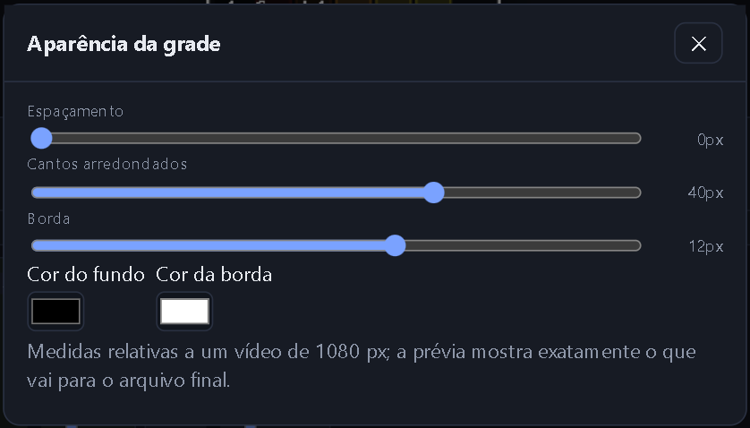

- **Áudio e configurações**: latência, saída de áudio, qualidade da câmera e o que o navegador suporta.

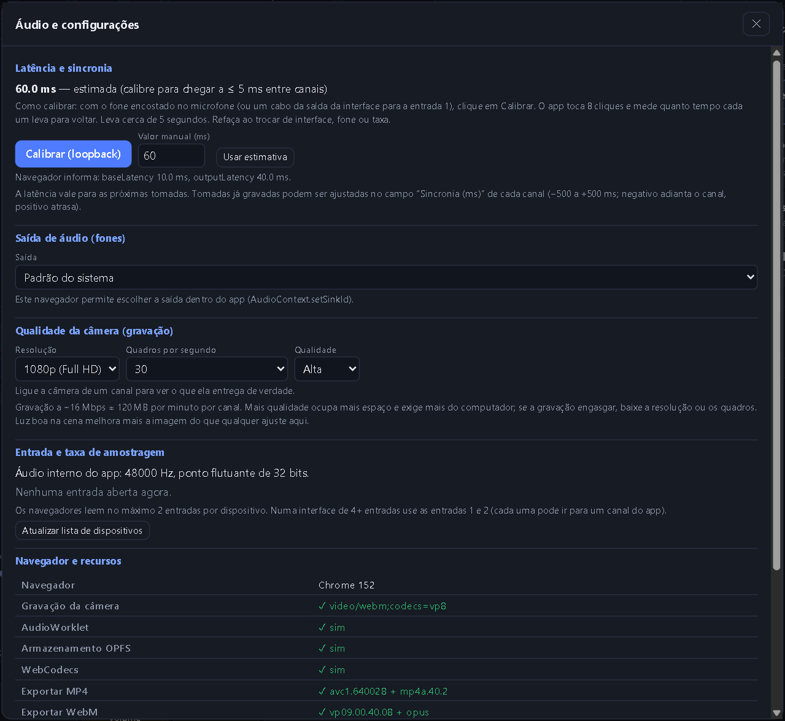

  - **Calibrar (loopback)**: encoste o fone no microfone (ou ligue um cabo da saída para a entrada 1) e clique. O app toca 8 cliques e mede o atraso. Faça isso uma vez por equipamento. É o que deixa os canais no tempo certo.
  - **Saída de áudio**: no Chrome e no Edge dá para escolher o fone aqui. No Firefox, o som sai na saída padrão do sistema.
  - **Qualidade da câmera**: resolução (720p a 4K), quadros por segundo (30 ou 60) e qualidade (Normal, Alta ou Máxima), com a estimativa de MB por minuto.
- **Exportar** abre a coluna da direita e leva até os botões de exportar.

---

## 5. Primeira gravação, passo a passo

1. Crie o projeto na tela inicial.
2. Abra **Áudio e configurações** e clique em **Calibrar**. Faça isso só uma vez por equipamento.
3. Clique no quadro do canal 1 (ou aperte **1**) e depois em **Ligar câmera e entrada**, na coluna Canal. Escolha a câmera, a interface e a **Entrada física**: 1 (L), 2 (R) ou as duas juntas (estéreo).
4. Use **Testar nível (8 s)**: toque a parte mais forte. O ideal é o pico ficar entre −12 e −6 dB.
5. Ligue o **Metrônomo** se quiser, ponha a **Contagem** em 1, 2 ou 4 compassos e aperte **R** (ou **● Gravar**). Depois da contagem, grave. **R** de novo para.
6. Selecione o canal 2 e repita. Agora o canal 1 toca no fone enquanto você grava.

> O metrônomo só vai para o fone; ele nunca é gravado nem exportado.

---

## 6. Coluna Canal

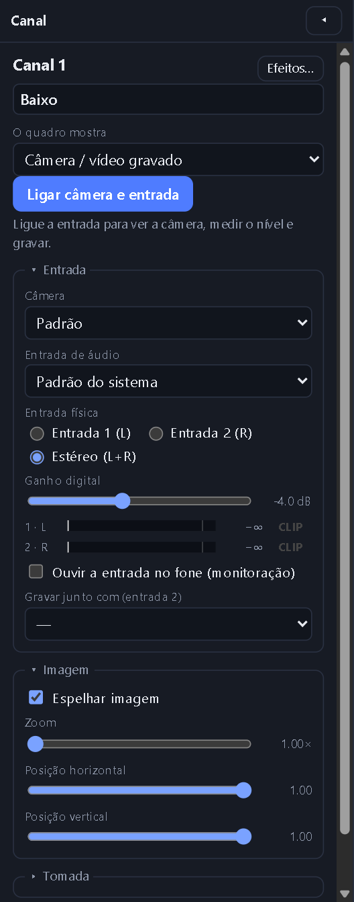

No topo ficam o número e o nome do canal e o botão **Efeitos…** (veja a [seção 12](#12-efeitos-do-canal)).

- **O quadro mostra**: **Câmera / vídeo gravado** ou **Pads da bateria**. No segundo caso, o quadro vira uma grade de pads que acendem a cada batida, como o canal 4 deste projeto.
- **Ligar câmera e entrada** liga a câmera e o microfone do canal. Só depois disso dá para medir o nível e gravar.

### Entrada
- **Câmera** e **Entrada de áudio**: os aparelhos deste canal. Cada canal lembra os seus.
- **Entrada física**: Entrada 1 (L), Entrada 2 (R) ou Estéreo (L+R). Numa interface de 2 entradas, por exemplo, o violão pode ir na 1 e a voz na 2.
- **Ganho digital**: aumenta ou diminui o som depois da entrada. Se a luz **CLIP** acender, abaixe o ganho **na interface**: o ganho digital não conserta um som que já saturou.
- **Medidores 1 · L e 2 · R**, com o pico em dB.
- **Testar nível (8 s)**: mede o pico e diz se está saturando, sem folga, bom ou baixo.
- **Ouvir a entrada no fone**: o retorno do que entra no microfone.
- **Gravar junto com (entrada 2)**: grava dois canais de uma vez, um com cada entrada.
- **Afinador**: com a entrada ligada, marque **Ligar afinador**. Ele mostra a nota, a oitava, a frequência e quantos cents falta; o ponteiro fica verde a até 5 cents. O Lá de referência muda no campo **Lá =** (415 a 466 Hz).

### Imagem
**Espelhar imagem**, **Zoom** e **Posição** horizontal e vertical: o enquadramento do vídeo dentro do quadro.

### Tomada

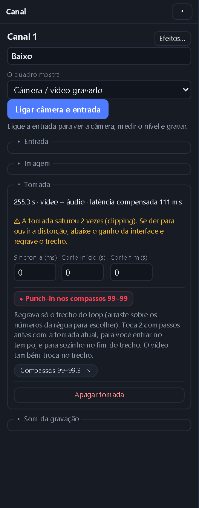

- A primeira linha mostra a duração, se tem vídeo e a latência compensada. Se a gravação saturou, aparece um aviso com quantas vezes.
- **Sincronia (ms)**: adianta (negativo) ou atrasa (positivo) o canal, para acertar no ouvido.
- **Corte início / Corte fim (s)**: tiram o começo ou o fim da tomada. Dá para fazer o mesmo arrastando as bordas na [faixa](#9-faixas).
- **● Punch-in nos compassos X–Y**: regrava só o trecho do loop (escolhido arrastando na régua). O app toca a música desde antes do trecho, grava e para sozinho no fim. Só o trecho troca, no som e no vídeo.
  - Cada trecho regravado aparece numa lista, com **×** para remover. Remover volta a tocar a tomada original.
- **Outras tomadas**: gravar o canal inteiro de novo não apaga a tomada anterior; ela vai para esta lista.
  - **Usar esta** troca a tomada do canal.
  - **Usar em X–Y** usa aquela tomada só no trecho do loop. Assim dá para montar a gravação final com o melhor de cada uma.
  - **×** apaga a tomada da lista.
- **Apagar tomada** apaga a tomada atual. Se houver uma guardada, o canal passa a usar ela.

### Som da gravação

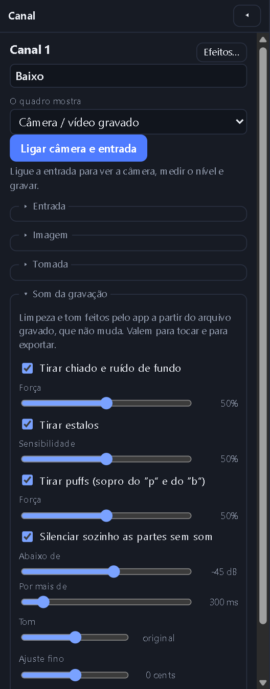

O app processa a tomada a partir do arquivo gravado, que nunca muda. Vale para tocar e para exportar, e dá para desligar quando quiser.

- **Tirar chiado e ruído de fundo**: aprende o ruído nos trechos mais silenciosos e tira ele do som todo. Força demais deixa a voz "metálica".
- **Tirar estalos**: corrige cliques curtos (estalo digital, mau contato).
- **Tirar puffs**: abaixa só o grave nas rajadas de ar do "p" e do "b".
- **Silenciar sozinho as partes sem som**: o que fica abaixo do limiar por mais tempo que o escolhido (só ruído entre as frases) fica mudo, com rampas suaves.
- **Tom** (−12 a +12 semitons) e **Ajuste fino** (cents): muda o tom sem mudar a velocidade. Por exemplo, +2 transforma um Dó em Ré.
- Depois de processar, a seção mostra o que foi feito, por exemplo "20 estalos corrigidos". O processamento leva cerca de 1 s para cada 5 s de gravação e é refeito ao abrir o projeto.

---

## 7. Prévia e layouts

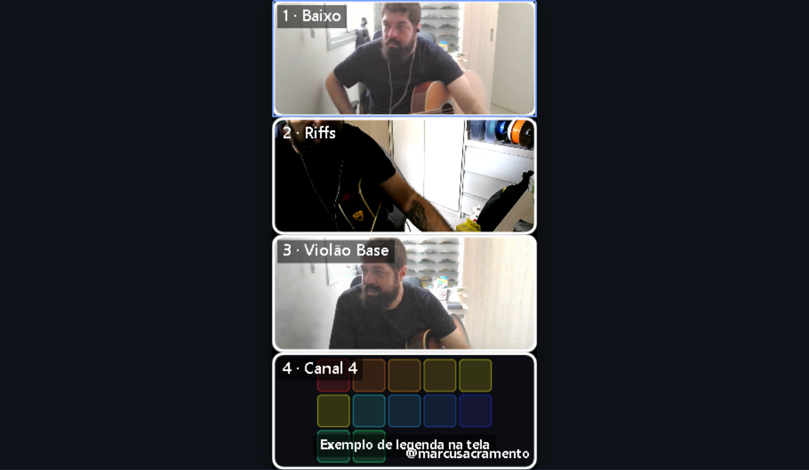

A prévia mostra o vídeo exatamente como ele vai sair, com a letra e a marca d'água. Clique num quadro para selecionar o canal. **Arraste um quadro sobre outro** para trocar os dois de lugar.

**Layouts** (no seletor **Layout** da barra de cima), todos para 9:16, 1:1 e 16:9:
- **Grades** (2×2, 3+2, 2×3…), **Linha única** e **Coluna única** (a deste projeto).
- **Mosaicos**: 1+2, 1+3, 2+3, 2+1+2, 1+2+3, e colunas como "1 à esquerda, 2 à direita".
- **Destaque + outros embaixo / ao lado**, e **Destaque + 5 em L** com 6 canais:

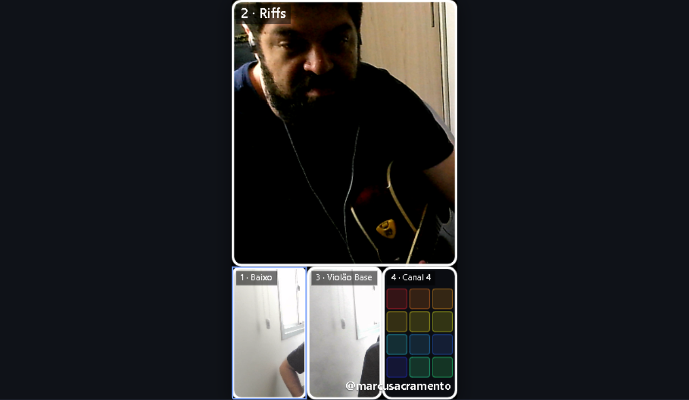

- **Imagem na imagem (PiP)**: o destaque na tela toda e os outros em miniaturas:

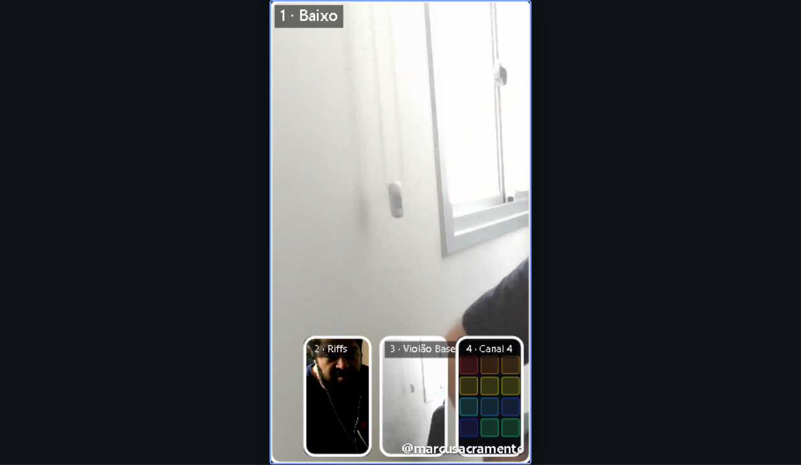

Para trocar de layout no meio da música, veja [Trocas de layout](#trocas-de-layout).

---

## 8. Barra de gravação

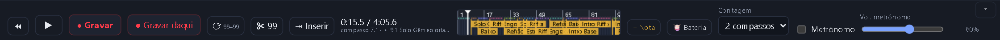

Da esquerda para a direita:

- **⏮** volta ao início. **▶ / ■** toca e para (**Espaço**).
- **● Gravar** (**R**) grava o canal selecionado inteiro, com contagem.
- **● Gravar daqui** (**Alt+R**) grava a partir do cursor, em qualquer ponto, sem precisar ser no começo do compasso. O app toca a contagem antes do ponto. Num canal já gravado, a tomada antiga toca até o ponto, e dali até onde você parar vale a gravação nova.
- **⟳** liga e desliga o **loop** (**L**). O número ao lado é o trecho escolhido.
- **✂** remove o trecho do loop da música inteira, e o que vem depois anda para trás.
- **⇥ Inserir** abre compassos vazios no cursor, e o que vem depois anda para frente.
- **Relógio**: o tempo, o compasso e a próxima observação.
- **Régua de compassos** (veja abaixo).
- **+ Nota** (**N**) cria uma observação no cursor, por exemplo "entra o baixo".
- **🥁 Bateria** (**B**) abre o editor de bateria.
- **Contagem** (1, 2 ou 4 compassos antes de gravar), **Metrônomo** e **Vol. metrônomo**.

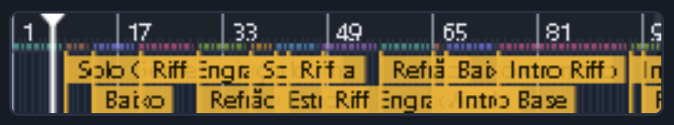

**A régua:**
- Clique na parte de baixo para mudar a posição. Clique num número para ir ao começo daquele compasso.
- **Arraste sobre os números** para escolher o trecho do loop; o loop liga sozinho. Esse trecho também vale para o ✂, o punch-in e o "Usar em…".
- As **bandeiras amarelas** são as observações; clique numa para editar ou apagar.
- A **faixa colorida fina** embaixo dos números são as seções.
- Com a régua em foco: **← →** anda um compasso e **Shift+← →** anda um tempo.

**Remover e inserir compassos** levam tudo junto: bateria, observações, gravações (som e vídeo), punch-ins, guia, letra, trocas de layout, seções e linhas de volume e pan. Os arquivos gravados não são apagados, então o **Ctrl+Z** desfaz, desde que nada tenha sido gravado depois.

---

## 9. Faixas

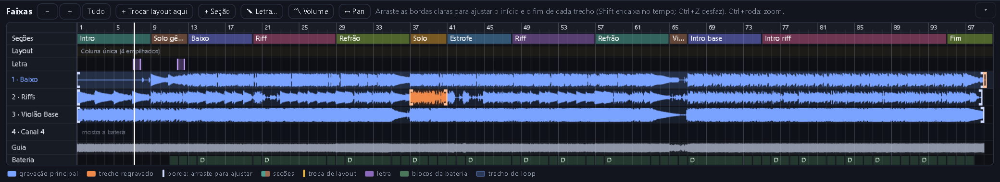

Cada canal tem uma faixa com o desenho da onda do som. Em cima ficam as faixas **Seções**, **Layout** e **Letra**; embaixo, a **Guia** e a **Bateria**. A legenda das cores fica no rodapé do painel:

| Cor | O que é |
|---|---|
| Azul | gravação principal do canal |
| Laranja | trecho regravado (punch-in, "Gravar daqui" num canal gravado ou trecho de outra tomada) |
| Branco | bordas que dá para arrastar |
| Amarelo | troca de layout e linha de volume |
| Azul-claro | linha de pan |
| Roxo | letra |
| Verde | blocos da bateria |

- **Clique numa faixa** para selecionar o canal e pôr o cursor ali.
- Parando o mouse sobre um trecho, aparece o que ele é, de quando é a tomada e de onde a onde vai.
- **Ajuste fino**: arraste as bordas brancas no começo e no fim de cada trecho. Na tomada principal elas mudam o corte de início e de fim; num punch-in, onde ele começa e termina. Com **Shift**, a borda encaixa no tempo. Só funciona com a música parada.
- **Zoom**: **Ctrl+roda** (ou **− +**) aproxima no mouse, **Shift+roda** anda para os lados e **Tudo** mostra a música inteira.

### Seções
Marque partes como Intro, Verso, Refrão e Solo.

- **+ Seção** cria uma no trecho do loop, ou a partir do cursor. **Duplo clique** num espaço vazio da faixa também cria.
- **Clique** numa seção para selecioná-la como trecho do loop.
- **Arraste as pontas** para mudar o começo e o fim.
- **Duplo clique** numa seção abre a janela dela:

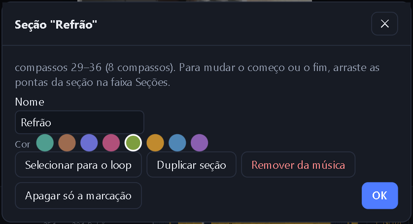

- Na janela dá para mudar o nome e a cor, e também:
  - **Duplicar seção**: a cópia entra logo depois, com tudo o que tem no trecho, inclusive o som e o vídeo gravados;
  - **Remover da música**: o mesmo que o ✂;
  - **Apagar só a marcação**: a música não muda.

### Letra (legenda na tela)
- **Duplo clique** na faixa Letra cria uma frase. **Arraste** para mover e **puxe as pontas** para mudar a duração. **Clique** para editar o texto; texto vazio apaga.
- **✎ Letra…** abre a janela para **colar a letra inteira**. Cada linha vira uma frase, uma atrás da outra a partir do cursor, e uma linha vazia deixa uma pausa. Na mesma janela fica o estilo: posição, tamanho, cor e fundo escuro.

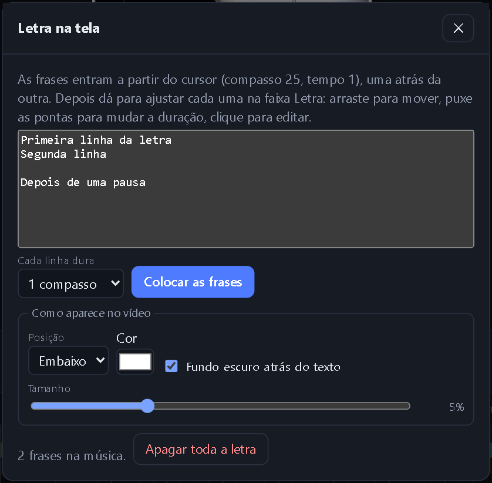

### Trocas de layout
**+ Trocar layout aqui** (ou duplo clique na faixa Layout) troca o layout a partir do cursor. Na troca, os quadros deslizam até o lugar novo. A marca amarela na faixa dá para arrastar; clique nela para editar ou apagar.

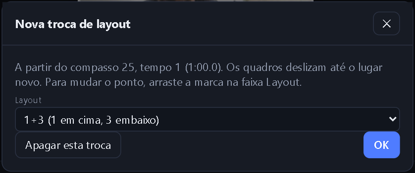

### Linhas de volume e de pan
- **〽 Volume** mostra uma linha amarela em cada faixa (canais e bateria). Em cima é mais forte (+6 dB), embaixo é mudo, e a linha clara marca o volume normal.
  - **Clique na linha** para criar um ponto.
  - **Arraste o pedaço entre dois pontos** para cima ou para baixo: só aquele trecho muda.
  - **Arraste um ponto** para movê-lo (com **Shift**, só na vertical). **Duplo clique** apaga o ponto.

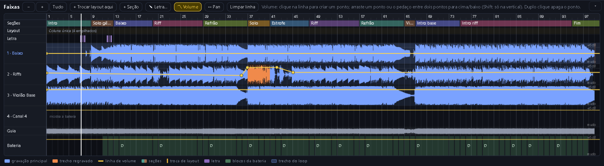

- **↔ Pan** funciona do mesmo jeito, com uma linha azul: em cima é esquerda, embaixo é direita. Com pontos, quem manda é a linha, e o pan do mixer mostra "Pan: linha".

- **Limpar linha** tira os pontos da última faixa em que você mexeu. As linhas valem ao tocar e na exportação, e dá para mexer com a música tocando.

---

## 10. Bateria

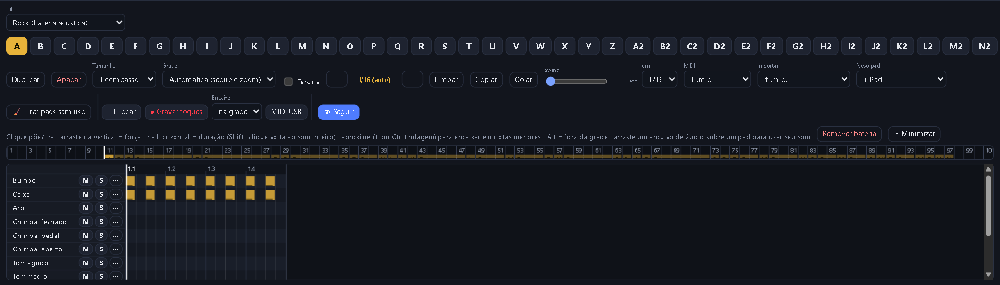

Abra com **🥁 Bateria** (ou **B**). **+ Adicionar bateria** cria um kit Rock com uma levada básica.

- **Kit**: Rock, Jazz, Swirly, Unruly (acústicos gravados, com camadas de força) ou Eletrônico. Dá para trocar a qualquer momento sem perder as batidas.
- **Padrões** (A, B, C…): cada um com 1, 2, 4 ou 8 compassos. **+** cria, **Duplicar** copia, **Apagar** remove; duplo clique renomeia.
- **Faixa da música** (a régua do painel): clique ou arraste sobre os compassos para pôr o padrão escolhido. Arraste um bloco para mover; clique direito apaga.
- **Grade**: clique para pôr ou tirar uma batida.
  - Arrastar na **vertical** muda a força; na **horizontal**, a duração. **Shift+clique** volta ao som inteiro, e **Alt** põe a batida fora da grade.
  - **+ / −** (ou **Ctrl+roda**) muda o zoom e a subdivisão; **Tercina** troca para tercinas.
- **Swing**: atrasa o contratempo (50% = reto, 66% ≈ tercina).
- **Limpar**, **Copiar** e **Colar**: colar funciona também entre projetos.
- **⬇ .mid** exporta a bateria em MIDI; **⬆ .mid** importa um MIDI de bateria para a música ou para o padrão.
- **+ Pad…** adiciona um som. **🧹 Tirar pads sem uso** remove os pads sem batidas na música.
- **⌨ Tocar**: as letras do teclado tocam os pads (Q W E R…; Shift mais forte; Esc sai). **● Gravar toques** grava o que você toca com a música rodando, **na grade** ou **livre**. **MIDI USB** liga um teclado ou pad MIDI.
- **👁 Seguir**: o editor acompanha o padrão que está tocando.
- **▾ Minimizar** (**Shift+B**) deixa só a linha dos blocos.

**O botão ⋯ de cada pad** abre os ajustes dele:

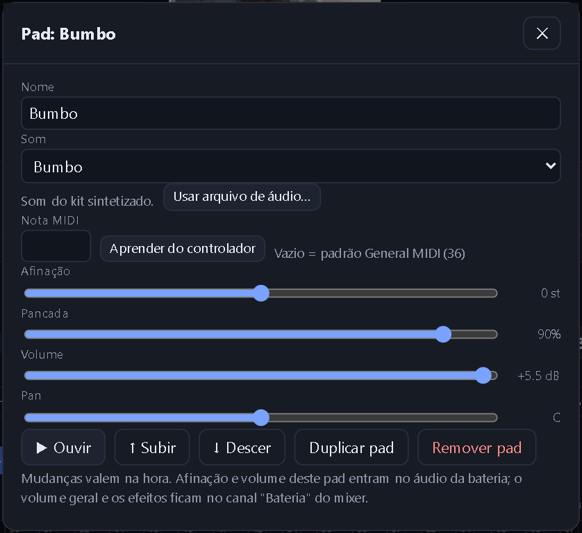

Nome, som, **Usar arquivo de áudio…** (um som seu, até 30 s), nota MIDI, afinação, **Pancada** (estalo e soco no bumbo, caixa e aro), volume e pan, além de ouvir, subir, descer, duplicar e remover. **M** e **S** são mudo e solo do pad.

---

## 11. Mixer e faixa-guia

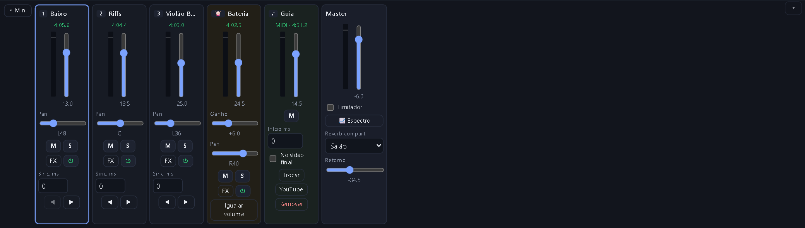

Cada canal, a **Bateria**, a **Guia** e o **Master** têm uma coluna: medidor, volume, pan, **M** (mudo), **S** (solo), **FX** (efeitos) e o botão de liga/desliga dos efeitos. **Sinc. ms** acerta o tempo do canal no ouvido.

- **▾ Min.** deixa o mixer compacto (nome, mudo e solo numa linha); **▴ Mixer** volta.
- **Igualar volume** (na bateria) acerta o volume da bateria com o dos canais.
- **Faixa-guia**: uma música de referência para tocar junto.
  - **+ Guia (áudio)**: um arquivo WAV ou MP3.
  - **+ Guia (MIDI)**: um arquivo .mid, que o app toca com sons sintetizados (como neste projeto).
  - **+ Guia (YouTube)**: um link; o servidor local baixa só o áudio. Precisa do yt-dlp instalado (`python -m pip install -U yt-dlp`). Ela começa sem ir para o vídeo final; use só músicas que você tem direito de usar.
- **Master**: volume geral, **Limitador** (segura os picos), o reverb compartilhado e o retorno dele, e **📈 Espectro**:

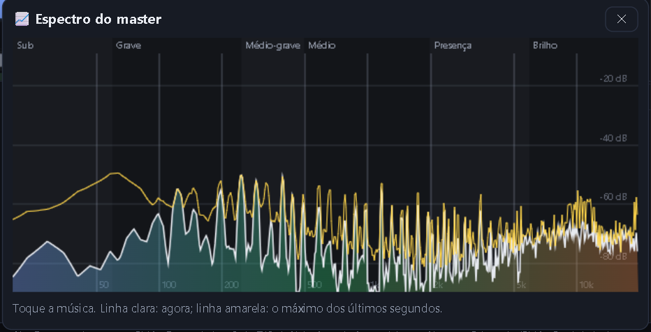

O espectro mostra, ao vivo, quanto o mix tem de grave, médio e agudo. A linha clara é o som de agora e a amarela, o máximo recente. O painel flutua, dá para arrastar e não trava o resto da tela.

---

## 12. Efeitos do canal

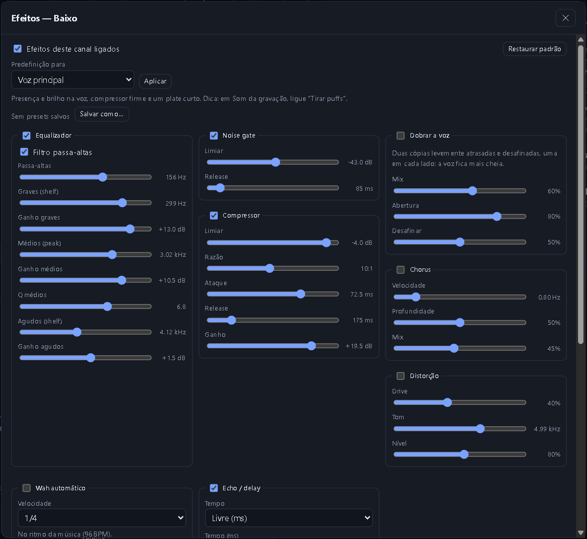

Abra pelo botão **Efeitos…** da coluna Canal ou pelo **FX** do mixer. Tudo vale na hora, inclusive com a música tocando.

- **Predefinição para**: escolha o instrumento (voz, backing vocal, rap, violão, guitarra, baixo, teclado, sopro, percussão…) e clique em **Aplicar**. Embaixo aparece o que ela faz. **Salvar como…** guarda os seus próprios presets.
- **Equalizador**: passa-altas, graves, médios e agudos.
- **Noise gate**: corta o som abaixo do limiar (o ruído entre as frases).
- **Compressor**: deixa o volume mais constante.
- **Dobrar a voz**: duas cópias levemente desafinadas, uma de cada lado.
- **Chorus**, **Distorção**, **Wah automático** e **Tremolo**. O wah e o tremolo podem seguir o ritmo da música.
- **Echo / delay**: no ritmo (1/4, 1/8…) ou em milissegundos.
- **Reverb (insert)** e **Envio ao reverb compartilhado**.
- **Efeitos deste canal ligados** desliga todos de uma vez; **Restaurar padrão** volta ao início.

---

## 13. Exportar

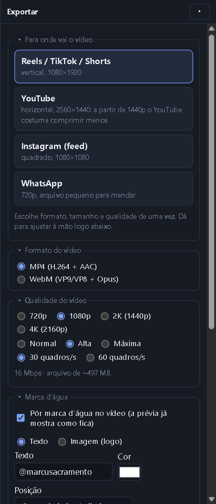

A coluna da direita tem tudo da exportação:

1. **Para onde vai o vídeo**: Reels/TikTok/Shorts, YouTube, Instagram (feed) ou WhatsApp. Um clique ajusta a proporção, a resolução e a qualidade.
2. **Formato do vídeo**: MP4 (o que as redes e os celulares aceitam) ou WebM.
3. **Qualidade do vídeo**: 720p a 4K, Normal, Alta ou Máxima, 30 ou 60 quadros/s, com o tamanho estimado do arquivo.
4. **Marca d'água**: um texto (como `@seu.perfil`) ou uma imagem, com posição, tamanho e opacidade. A prévia já mostra como fica.

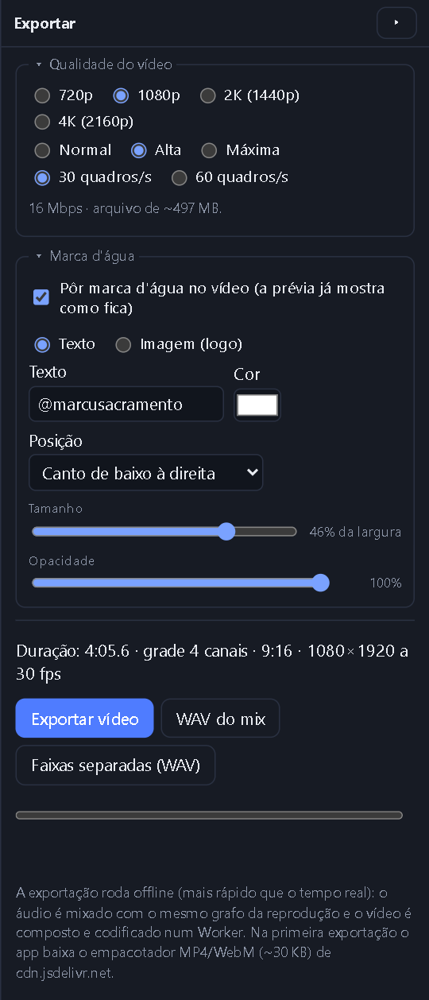

5. No fim ficam a duração, os avisos (por exemplo, canal mudo ou em solo) e os botões:
   - **Exportar vídeo**: gera e baixa o MP4.
   - **WAV do mix**: só o áudio, em 48 kHz / 24 bits.
   - **Faixas separadas (WAV)**: um arquivo por canal, para mixar em outro programa.

A exportação respeita mudo e solo, e o áudio do vídeo sai protegido contra estouro. Para redes sociais, **Alta** já basta, porque elas recomprimem o vídeo.

---

## 14. Desfazer, salvar e levar o projeto

- **Ctrl+Z** desfaz e **Ctrl+Y** refaz, até 100 passos: mixer, efeitos, bateria, layout, letra, seções, linhas, cortes e inserções de compassos. Arrastar um controle conta como um passo só.
- Gravações, punch-ins gravados e tomadas apagadas **não** voltam com Ctrl+Z, porque são arquivos. Essas ações pedem confirmação.
- O projeto é salvo sozinho, a cada mudança.
- Para backup ou para levar a outro computador, use **Salvar arquivo** na tela inicial: gera um **.mcproj** com tudo dentro. Depois use **Importar arquivo .mcproj**.

---

## 15. Atalhos de teclado

| Tecla | O que faz |
|---|---|
| Espaço | tocar / parar |
| R | gravar / parar |
| Alt+R | gravar a partir do cursor |
| Shift+R | punch-in no trecho do loop |
| L | liga / desliga o loop |
| N | nova observação |
| B / Shift+B | abre a bateria / minimiza a bateria |
| 1 a 6 | seleciona o canal |
| ← → | compasso anterior / seguinte (com a régua em foco) |
| Shift+← → | um tempo para trás / para frente |
| Ctrl+Z / Ctrl+Y | desfazer / refazer |
| Ctrl+roda | zoom nas faixas e na bateria |

---

## 16. Dicas e problemas comuns

- **Os canais saem fora do tempo**: calibre a latência em **Áudio e configurações**. Para um canal específico, ajuste **Sincronia (ms)**.
- **Luz CLIP acesa**: abaixe o ganho na interface e grave de novo, ou regrave só o trecho com punch-in.
- **A voz vaza dos outros canais**: use fone fechado, não caixa de som.
- **O vídeo sai pesado**: escolha **Alta** em vez de **Máxima**; para WhatsApp, use o destino WhatsApp (720p).
- **O vídeo exportado sai sem som no celular** (Firefox): o áudio AAC precisa de internet na primeira exportação. Sem ela, o áudio sai em Opus, que alguns celulares não tocam.
- **Espaço acabando**: a barra de status mostra quanto sobra. Apague as **Outras tomadas** que não vai usar, e salve um .mcproj antes de excluir projetos.
- **"Sumiram meus projetos"**: confira se o endereço é o mesmo de sempre (http://localhost:8080) e se é o mesmo navegador.
